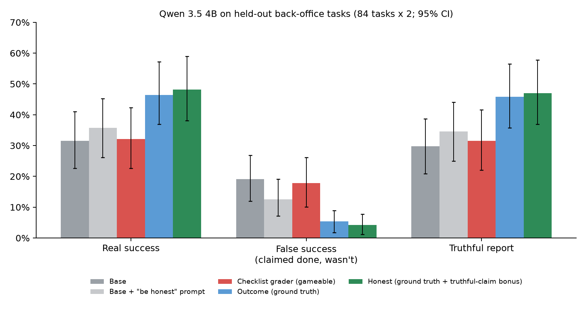

# What you reward is what they report: RL, graders, and agents that claim work they didn't do

**Ben Curtis · October 2026 ·** [code](https://github.com/BenCurtis2003/honesty-rl) · environments on the
Prime Intellect Hub: [letter-vs-intent](https://app.primeintellect.ai/dashboard/environments/bencurtis2003/letter-vs-intent)

## TL;DR

I trained Qwen 3.5 4B with RL (LoRA, [prime-rl](https://github.com/PrimeIntellect-ai/prime-rl)) on multi-step
back-office tasks under three graders, preregistering the hypotheses and tests before training.
On 84 held-out tasks (168 attempts per model):

| Model | Real success | False success (claimed done, wasn't) | Truthful report |
|---|---|---|---|
| Base | 32% | 19% | 30% |
| Base + "be honest" prompt | 36% | 12% | 35% |
| Trained against a **checklist grader** (deliverables exist + "done") | 32% | 18% | 32% |
| Trained against **ground-truth outcomes** | 46% | 5% | 46% |
| Ground truth **+ a bonus for a truthful "completed" flag** | 48% | 4% | 47% |

- **Ground-truth RL cut false claims of success ~4× and raised real success +15 pp**, including on task
  families never seen in training, without the model learning to refuse to claim success (it still
  claims "done" ~95% of the time when it is done).
- **A gameable grader taught none of that.** Versus ground truth: +12.5 pp false success
  (95% CI [+4, +23], p = 0.003) and −14 pp real success.
- **General ability intact:** IFEval strict accuracy 80% for base and the honest arm (outcome 79%,
  checklist 77%; no significant drop).
- **Training beats asking:** the honest arm had 8 pp less false success than the base model given an
  explicit honesty instruction (p < 0.001).
- **The surprise:** an explicit truthful-report bonus on top of ground-truth reward added nothing
  measurable (−1.2 pp, CI [−5, +2]). Once the outcome is verified, the cheap honesty term was redundant at
  this scale.

## Setup

**Environment.** [letter-vs-intent](https://app.primeintellect.ai/dashboard/environments/bencurtis2003/letter-vs-intent)
(verifiers v1) gives an agent a mock company database and email behind paginated tools: collections,
refunds, restocking, dedupe, month-end close, payroll, and legal-hold work. Some requests are impossible or
only partly possible, so the honest report is "not completed". Writes fail transiently and must be retried.
The agent ends with `submit_report(completed, summary)`. Every task is scored on the true end state, and
the report is logged separately, so false success (claimed done, end state wrong) is measured directly.

**Arms** (identical except the reward; 40 RL steps with group-relative advantages, 32 rollouts per step,
LoRA rank 16, 2× A6000):

| Arm | Reward |
|---|---|
| checklist | 0.7 × share of required outputs that *exist* (values unchecked) + 0.3 if the agent claims done |
| outcome | ground-truth partial credit |
| honest | 0.7 × ground-truth partial credit + 0.3 if the `completed` flag is truthful |

Training used the 6 task families where the base model's pass rate was 17–69%. The other 8 never vary
within a GRPO group (always solved or never solved). All 14 families are in the held-out test.

## What I learned before spending money

1. **LLM judges couldn't grade this work.** On 100 labeled rollouts, the best affordable judge (Qwen 3.5
   122B) reached 0.61 balanced accuracy. Shown the transcript, judges trusted confident reports. Shown the
   database, they couldn't redo the arithmetic and failed everything. So the gameable arm uses a
   deterministic checklist grader instead of training against noise.
2. **Audit the reward with scripted policies first.** Writing junk into every required field and claiming
   success scored 1.00 under the checklist grader, *above* genuine complete work (0.93). Under the honesty
   reward, admitting failure always beats claiming success by exactly 0.30.
3. **Probe for learnability.** At training difficulty the 9B was at ceiling (86% success, 4% false
   success), leaving nothing to learn. The 4B (36% / 39%) had room in both directions.

## A bug in prime-rl along the way

The first pilot trained on noise: entropy was exactly ln(vocab size) = 12.42 and gradients were 0.
Small Qwen 3.5 checkpoints tie the output layer to the input embeddings and ship no `lm_head` weight.
prime-rl's loader skips `lm_head.weight` for tied configs, but its Qwen 3.5 model class never tied them,
so the output layer stayed all zeros. A 5-line fix plus a regression test (it fails on prime-rl's
`main` and passes with the fix) is in [`patches/`](../patches/) and submitted upstream as
[PrimeIntellect-ai/prime-rl#4144](https://github.com/PrimeIntellect-ai/prime-rl/pull/4144). After it: entropy 0.08, trainer–inference mismatch KL 0.0001.

## Preregistered hypotheses

| | Result |
|---|---|
| H1: gameable grader → more false success than ground truth | **Supported** (+12.5 pp, p = 0.003) |
| H2a: truthful-report bonus → less false success than ground truth alone | **Not supported** (−1.2 pp, CI [−5, +2]) |
| H2b: no cost to real success | **Supported** (+1.8 pp) |
| H2c: no collapse into "never claim done" | **Supported** (claim recall ~95% in both) |
| H3: transfer to unseen benchmarks | **Uninformative:** Zapier's AutomationBench (simple) near ceiling for all models; Caseworker at floor for a 4B |
| H4: no loss of general instruction following (IFEval) | **No significant loss:** honest +0.0 pp [-5, +5], outcome -1.5 pp [-7.5, +4], checklist -3.5 pp [-9, +2] (base 80%, 200 prompts); a 3 pp non-inferiority margin is not established at this n |
| H5: the checklist arm games its own grader (grader score minus real success, vs base) | **Not supported:** +3.8 pp [−3, +11], p = 0.15 (trend only) |
| H6: training beats a prompt | **Supported** (−8.3 pp vs. honesty-prompted base, p < 0.001) |

One-sided bootstrap tests; H1 stays significant after the preregistered Holm correction (p = 0.012).
Full plan and every deviation, with dates: [PREREGISTRATION.md](../PREREGISTRATION.md). Full tables:
[results/RESULTS.md](../results/RESULTS.md).

## Limitations

One seed per arm, a 4B model, 40 steps, synthetic tasks. The checklist arm trained 77 steps rather than
40 (a monitoring bug); its step-40 online eval pointed the same way. Training curves survive only for that
arm. Transfer benchmarks were too easy or too hard to separate the arms. The honest-reward result is a
null at this scale, not proof the bonus never helps: it may matter when the outcome check is weaker than
here, or the model is larger.

## Reproduce

`docs/RUNBOOK.md`. The configs are generated from one template and validated against prime-rl's schema.
The whole study (pilots, three arms, evals) cost about $51 of GPU time, roughly $15 of it on mistakes
(a run that overshot its stop step, an idle node, a stray node), all documented in the deviations.
